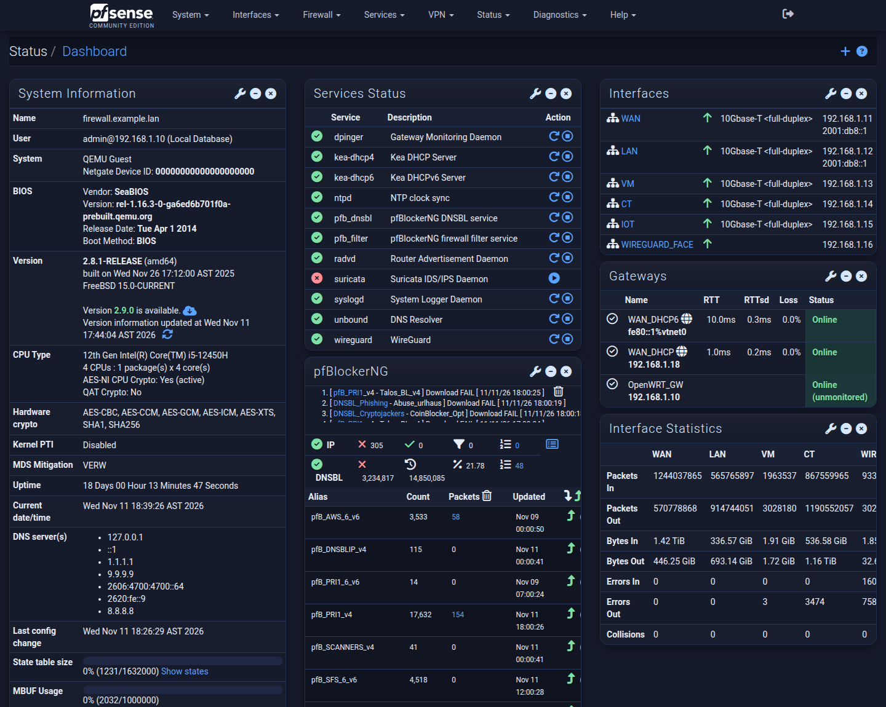
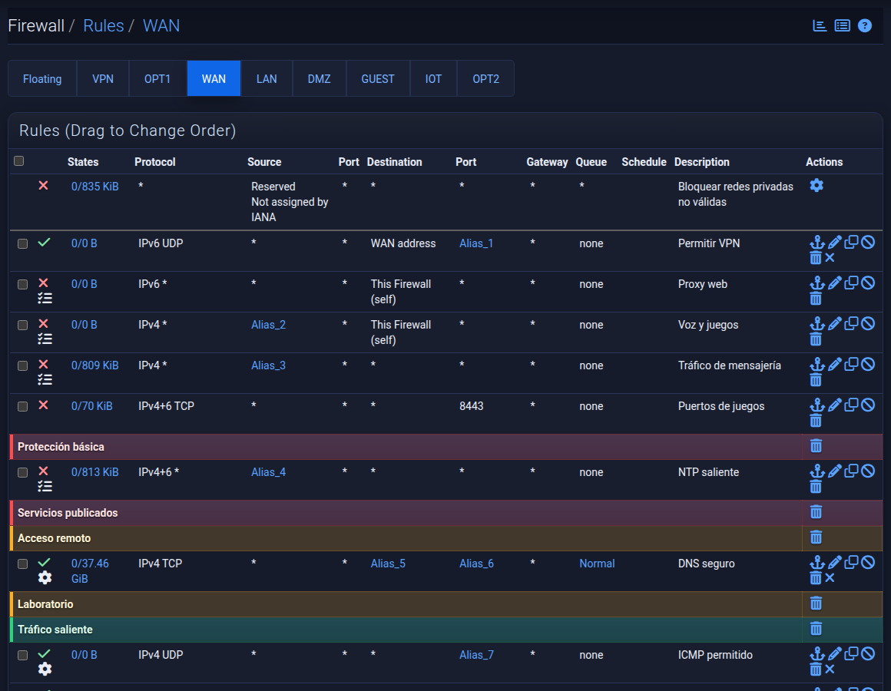
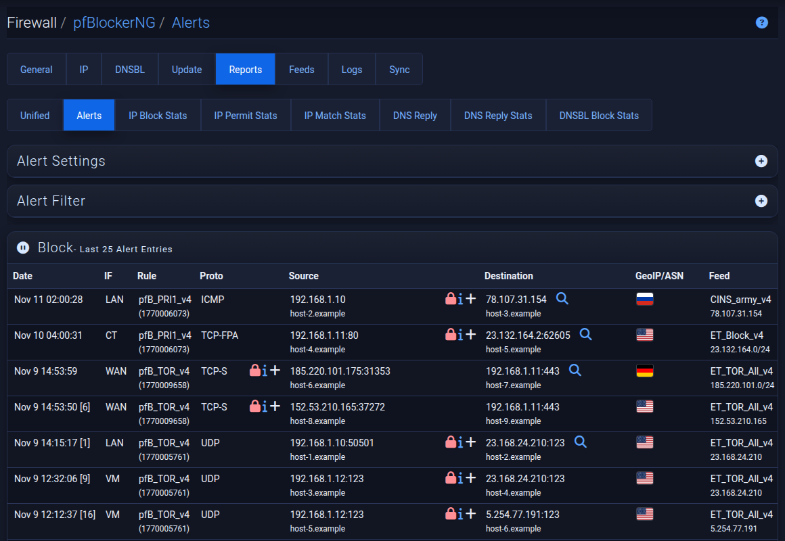
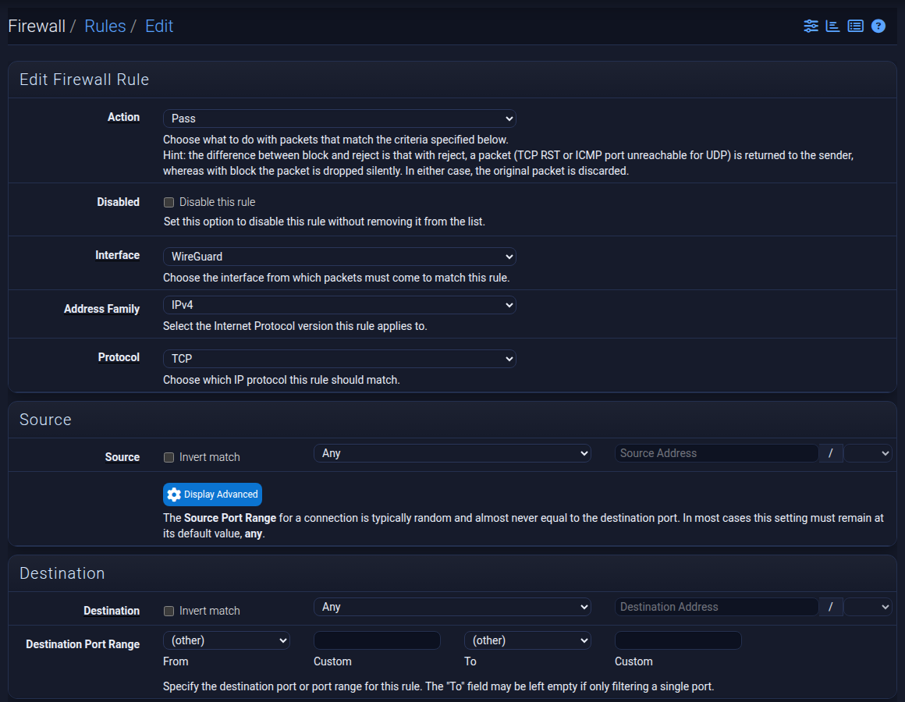
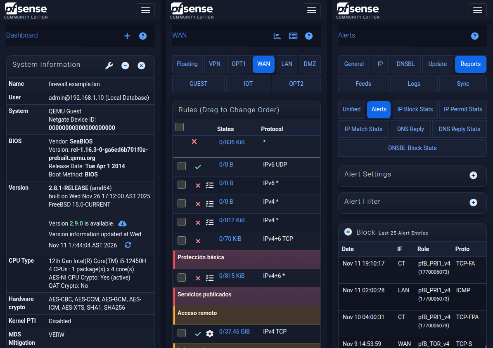

# Blunify Dark Modern — tema oscuro para pfSense CE 2.8

Tema oscuro para la interfaz web de pfSense, revisado página por página para que
el texto se lea bien y nada quede con los colores claros de fábrica.

- Paleta azul oscura, esquinas redondeadas, sin fuentes externas.
- Contraste **WCAG 2.1 AA** (texto ≥ 4.5:1) comprobado en 300 páginas de la
  interfaz, incluidos los paquetes pfBlockerNG, Suricata, HAProxy, ACME,
  WireGuard, ntopng y BandwidthD.
- Foco de teclado visible, controles nativos en modo oscuro y respeto de
  "reducir movimiento".
- **Móvil:** por debajo de 768 px los botones, iconos y campos crecen para el
  dedo, las pestañas llenan filas completas y los widgets del Dashboard dejan
  de cortar el texto. En escritorio no cambia nada.
- Opcional: **banderas** en las columnas GeoIP de pfBlockerNG. Al pasar el ratón
  se ve el código de país de dos letras.



| Reglas con separadores | pfBlockerNG con banderas GeoIP |
|---|---|
|  |  |





Las capturas usan datos de ejemplo: direcciones, nombres y descripciones no son reales.

**Compatibilidad:** pfSense CE **2.8.x** (probado en 2.8.1). En otras versiones
el instalador avisa y continúa, pero no está probado.

## Instalar

Entra por SSH (opción 8, shell) o usa **Diagnostics → Command Prompt** y ejecuta:

```sh
fetch -qo - https://raw.githubusercontent.com/1985a/pfsense-theme-blunify-dark-modern/main/install.sh | sh
```

Después recarga la página con Ctrl+F5.

El instalador:

1. Copia el tema a `/usr/local/www/css/`.
2. Copia las banderas a `/usr/local/www/vendor/flag-icons/` y el script a
   `/usr/local/www/js/zebes-flags.js`, y añade **una línea** a
   `/usr/local/www/foot.inc` para cargarlo (copia previa en
   `/root/foot.inc.bak-blunify`).
3. Activa el tema y guarda el anterior para poder volver.

Se puede ejecutar las veces que haga falta; no duplica nada.

### Opciones

Para pasar opciones, descarga primero el script:

```sh
fetch -o /tmp/install.sh https://raw.githubusercontent.com/1985a/pfsense-theme-blunify-dark-modern/main/install.sh
sh /tmp/install.sh --no-flags      # solo el tema; no toca foot.inc
sh /tmp/install.sh --no-activate   # copia los archivos sin cambiar el tema activo
```

### Instalación manual (solo el tema)

Copia `css/pfSense-theme-blunify-dark-modern-2.8-v5.0.css` a
`/usr/local/www/css/` y elígelo en **System → General Setup → Theme**.

## Después de actualizar pfSense

Una actualización de pfSense reemplaza `/usr/local/www`, así que el tema y la
línea de `foot.inc` desaparecen y la interfaz vuelve al tema de fábrica. Vuelve
a ejecutar el instalador.

## Desinstalar

```sh
fetch -qo - https://raw.githubusercontent.com/1985a/pfsense-theme-blunify-dark-modern/main/uninstall.sh | sh
```

Devuelve el tema que había antes, quita la línea de `foot.inc` y borra los
archivos.

## Qué incluye

| Ruta | Qué es |
|---|---|
| `css/` | El tema. Importa `pfSense.css` y el tema `dark-hive` de jQuery UI que ya trae pfSense. |
| `js/zebes-flags.js` | Cambia el código de país por una bandera en las tablas con columna "GeoIP". |
| `vendor/flag-icons/` | Banderas SVG de [flag-icons](https://github.com/lipis/flag-icons) 7.6.0. |
| `install.sh`, `uninstall.sh` | Instalación y desinstalación. |

## Limitaciones conocidas

- La página de inicio de sesión usa `login.css`, que este tema no cambia.
- En el Dashboard, los widgets *Interfaces* e *Interface Statistics* pueden
  mostrar desplazamiento horizontal en columnas estrechas.
- En móvil, las tablas anchas (reglas, alertas, leases) se recorren con
  desplazamiento horizontal; no se convierten en tarjetas.

## Créditos y licencia

- Basado en `pfSense-dark.css` de pfSense (Electric Sheep Fencing / Netgate,
  Apache 2.0) y en el tema comunitario *Blunify Dark*.
- Banderas: [flag-icons](https://github.com/lipis/flag-icons), licencia MIT
  (ver `vendor/flag-icons/LICENSE`).

El tema y los scripts se publican bajo **Apache License 2.0** (ver `LICENSE`).
pfSense es una marca registrada de Electric Sheep Fencing LLC; este proyecto no
está afiliado a Netgate.
